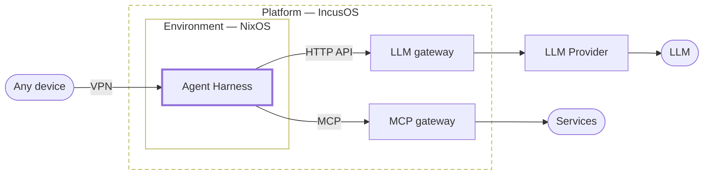

<picture>
  <source media="(prefers-color-scheme: dark)" srcset="https://raw.githubusercontent.com/langify-org/.github/main/branding/wordmark-dark.svg">
  
</picture>

Research and development on self-hosted, always-on AI agents.

Like Muse, dot, Claude Duet, and Grok Bot, AI agents are moving onto computers of their own, running around the clock.\
langify.org researches and builds what it takes to self-host them, and open-sources it.

- **Always-on**\
  Close your laptop, and your agent stops.\
  Here, agents run around the clock on a dedicated machine, keeping their conversations and state.
- **Anywhere**\
  Talk to the same agent and hand it work from any device.
- **Replaceable**\
  Models, tool protocols, and harnesses turn over every few months.\
  The platform is split into layers joined by standard protocols, so each can be swapped on its own.
- **Secure by design**\
  The way in to the agents stays inside a VPN, never on the internet.\
  The host runs IncusOS: immutable, and self-updating.\
  Credentials live in 1Password, and agents reach only what they need.

## Projects

- [deepseek-harness-plugins](https://github.com/langify-org/deepseek-harness-plugins) — Plugins for DeepSeek Harness: Discord, code-server, conversation forks

[langify.org](https://langify.org)
